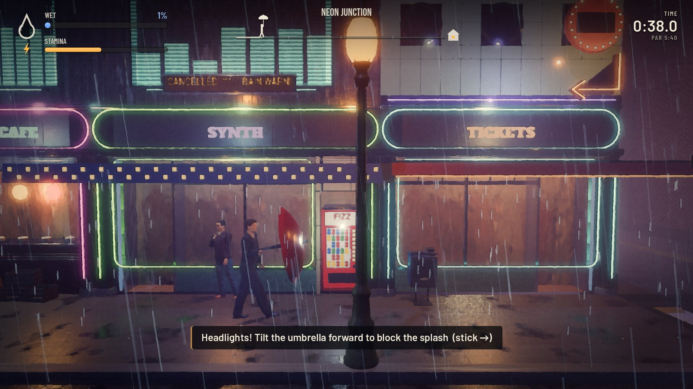
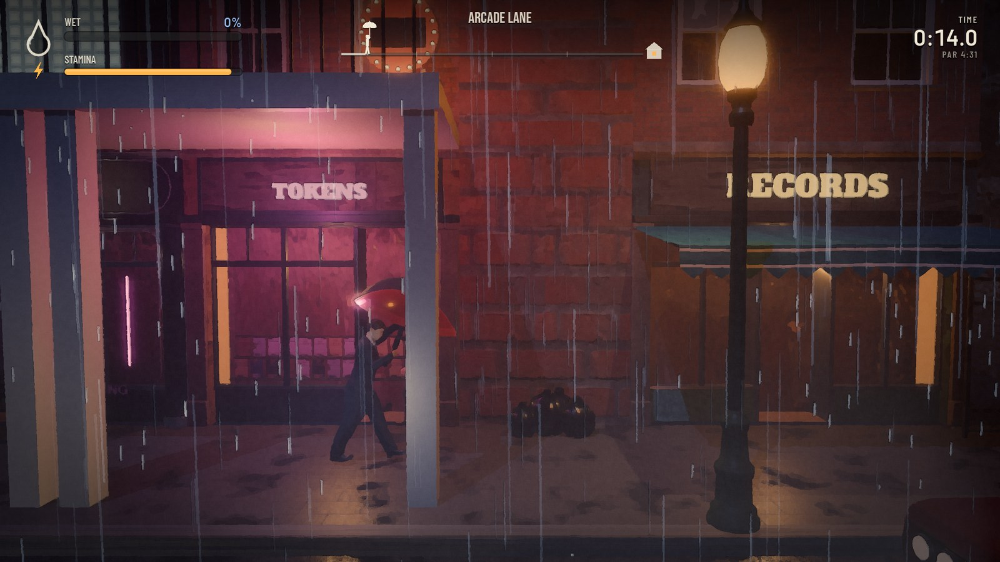
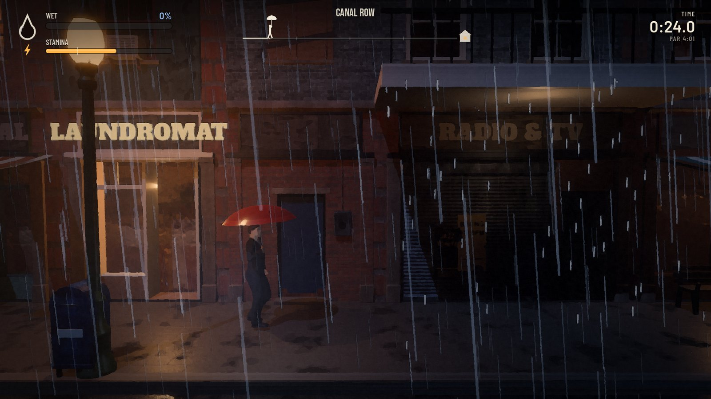
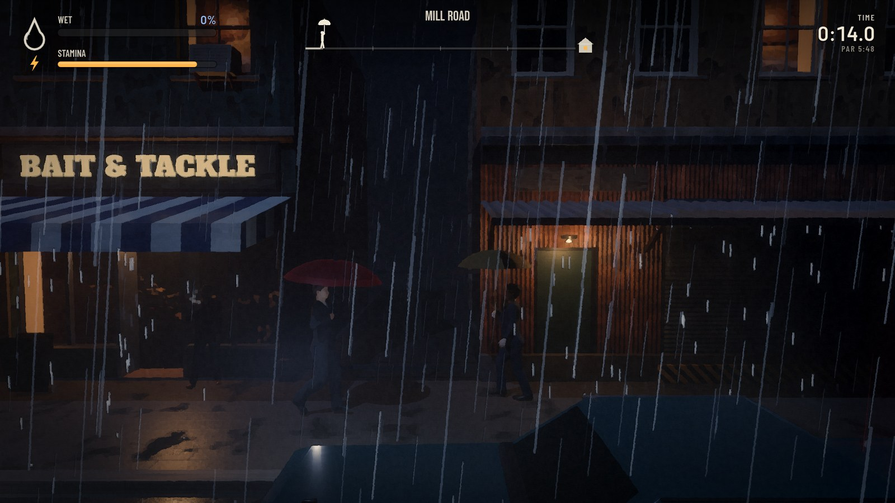
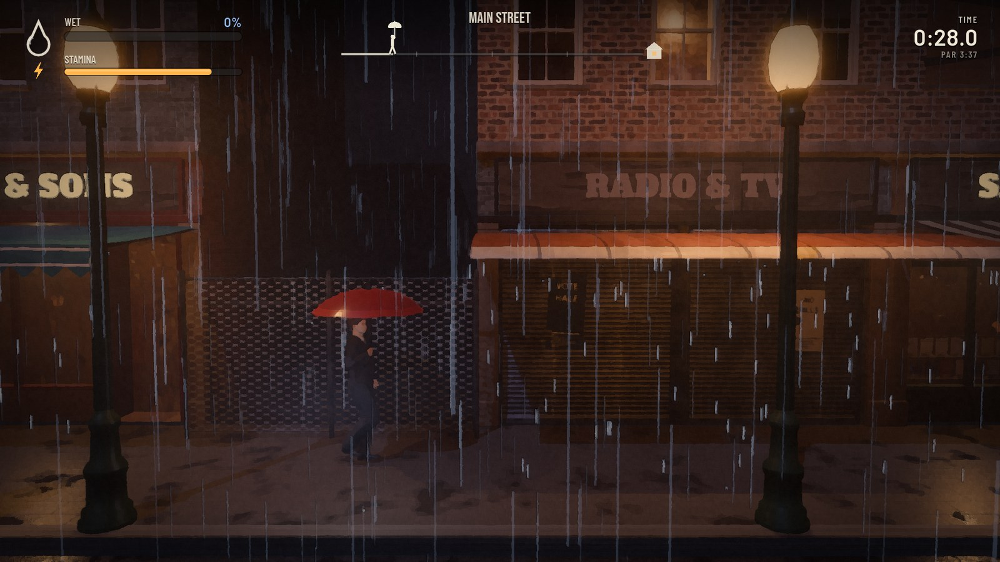
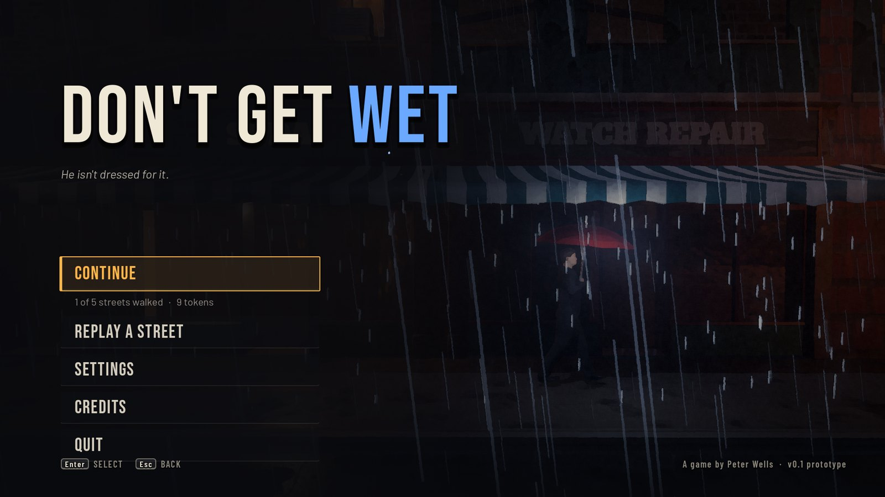
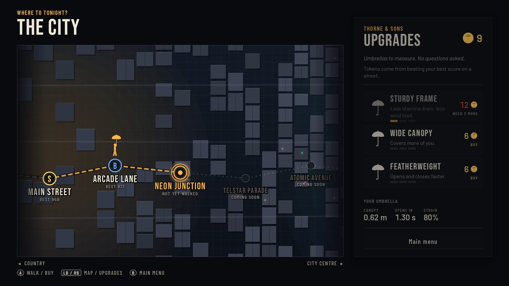

# Don't Get Wet

A game by **Peter Wells**.

It never stops raining in this city, and he isn't dressed for it. He walks forward — your job is
to get him to shelter as dry as you can: open the umbrella under rain, close it under cover to
get your breath back, hurry across the gaps, tilt into the wind, and watch out for passing cars.

> **Alpha v0.1.0** — an early version. Expect rough edges, and tell us what you think!



<table>
  <tr>
    <td></td>
    <td></td>
  </tr>
  <tr>
    <td></td>
    <td></td>
  </tr>
  <tr>
    <td></td>
    <td></td>
  </tr>
</table>

## Download and play

Get the latest version from the [**Releases**](../../releases) page — just download the one file
for your computer. There's nothing to install.

**Windows** — download the file ending in **`-windows.exe`** and double-click it.
If Windows says it protected your PC, click **More info → Run anyway** (the game isn't signed yet).

**Linux / Steam Deck** — download the file ending in **`-linux.x86_64`**. The first time, right-click
it → **Properties → Permissions** → tick **Is executable** (or "Allow executing file as program"),
then double-click it. On Steam Deck, do this in Desktop Mode; you can also add it to Steam with
**Add a Non-Steam Game** to play it in Game Mode.

A gamepad is recommended, but keyboard and mouse work too.

## How to play

- **Rain soaks you wherever the sky is open.** Fill the wetness meter and it's game over.
- **The umbrella takes a moment to open**, and holding it up tires you out.
- **Close it under cover** (awnings, balconies) — stamina only comes back while it's closed.
- **Watch for gutters, wind and cars.** Keep the umbrella upright under overflowing gutters, tilt it
  into slanting rain, and tilt it forward when headlights come — cars splash!
- **Sunny breaks dry you off** — close the umbrella and enjoy them.
- Beat your best score on a street to earn tokens for umbrella upgrades.

## Controls

| Action | Gamepad | Keyboard / mouse |
|---|---|---|
| Open umbrella (hold — press lightly to half-open) | RT | Right mouse button or Space |
| Hurry (press fully to run) | LT | Shift (W for a brisk walk) |
| Stop for a breather (when puffed out) | LB | S |
| Tilt the umbrella | Either stick | Q / E or mouse wheel |
| Pause | Start | Esc |
| Restart the street | Back | R |

Touch screens get on-screen controls.

## Credits

Characters, sounds, fonts and other assets are listed in [`assets/CREDITS.md`](assets/CREDITS.md).

---

## Developers

Built with **Godot 4.7** (GDScript, Forward+ renderer). Design notes: [`docs/DESIGN.md`](docs/DESIGN.md).
Content interfaces: [`docs/CONTRACTS.md`](docs/CONTRACTS.md).

### Running from source

```sh
godot --path .                 # play (opens the main menu)
godot --path . --editor        # open in the editor
```

Builds: export the **Linux** and **Windows Desktop** presets (to `build/linux/` and `build/windows/`).

### Tools

```sh
python3 tools/level_gen.py                   # regenerate first-draft level layouts into levels/*.json
tools/playtest.sh [--human] [level ...]      # autopilot bot plays levels headless, prints score & wetness sources
godot --headless --path . res://tests/run_tests.tscn   # rain-exposure / umbrella / splash tests
tools/shots.sh OUT_DIR "1,3,5" res://src/level/level.tscn --autopilot --level=main_street --start-x=40
python3 tools/grid.py sheet.png OUT_DIR/shot_*.png      # contact sheet of screenshots
tools/posture_sheet.sh OUT.png               # walker posture contact sheet
```

Debug game args (after `--`): `--level=ID`, `--autopilot`, `--human`, `--lazy` (never opens the
umbrella), `--start-x=M`, `--wet=N`, `--fps-log`, `--shots=t1,t2 --shot-dir=DIR`.

Gameplay numbers live in [`data/tunables.json`](data/tunables.json).

### Layout

```
src/core     autoloads: Tun (tunables), Inputs, Game (progression, save, scene flow)
src/player   walker controller, umbrella, placeholder character
src/level    level runner, street builder, features, traffic
src/hazards  side-street cars
src/fx       rain particles, painterly post filter, shaders
src/audio    level soundscape
src/ui       HUD, menus, city map, touch controls
levels/      fixed level layouts (JSON) + map graph (index.json)
assets/      character, building kit, props, materials, audio, fonts (see CREDITS.md)
tools/       level generator, Blender kit generators, audio generators, test tooling
```
